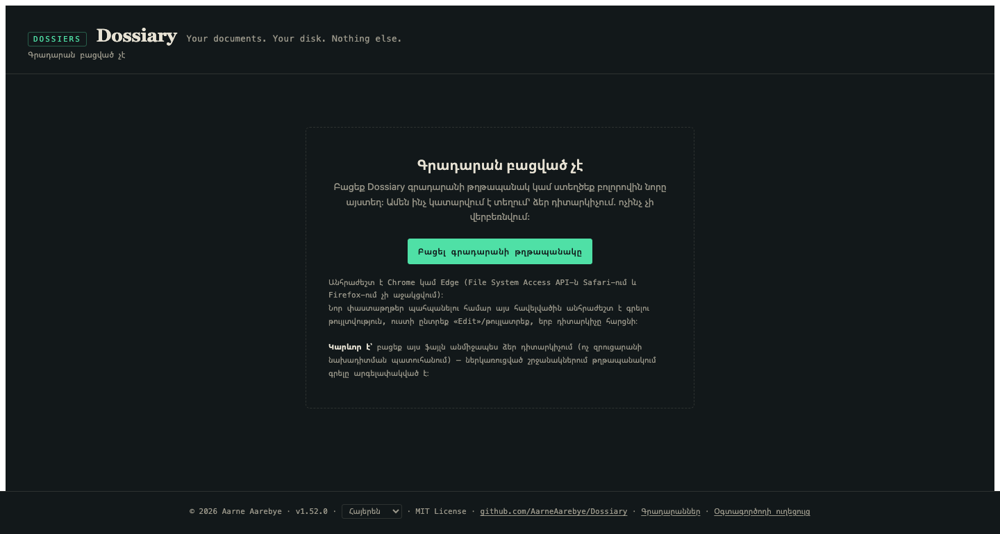
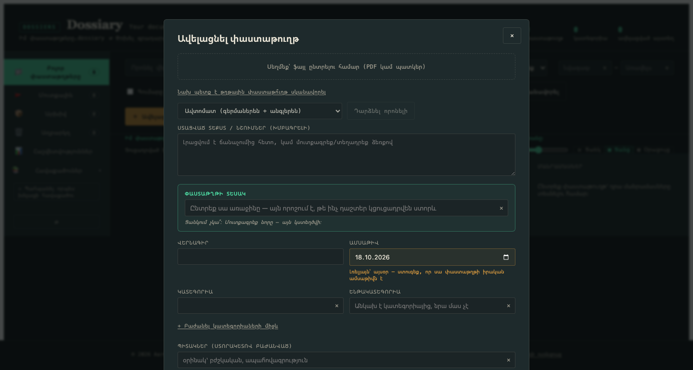
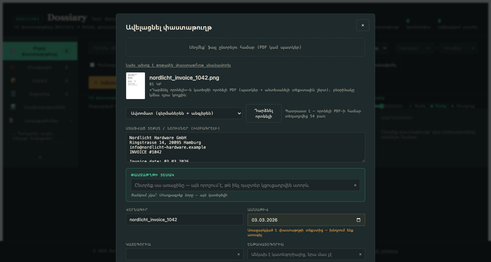
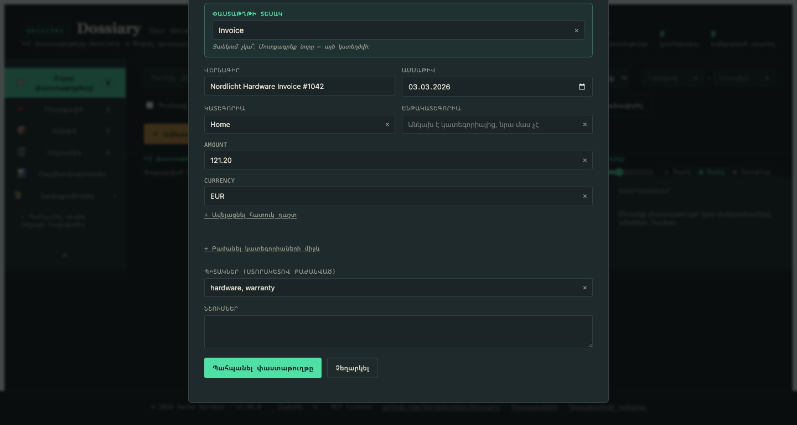
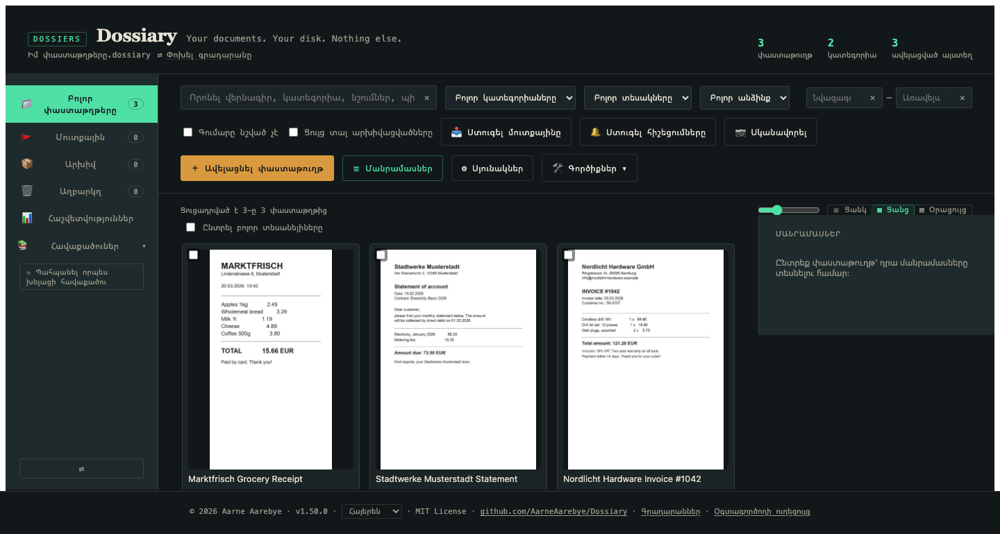
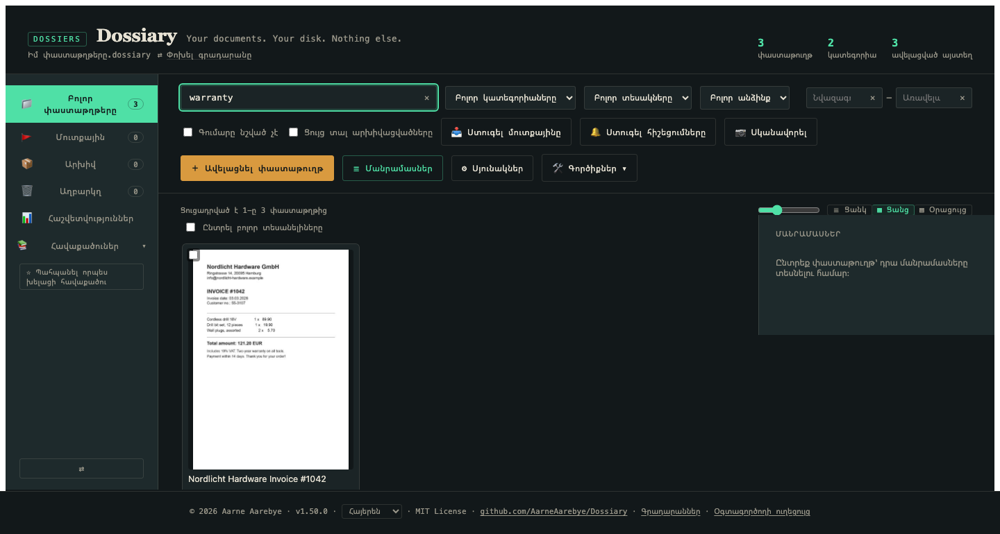
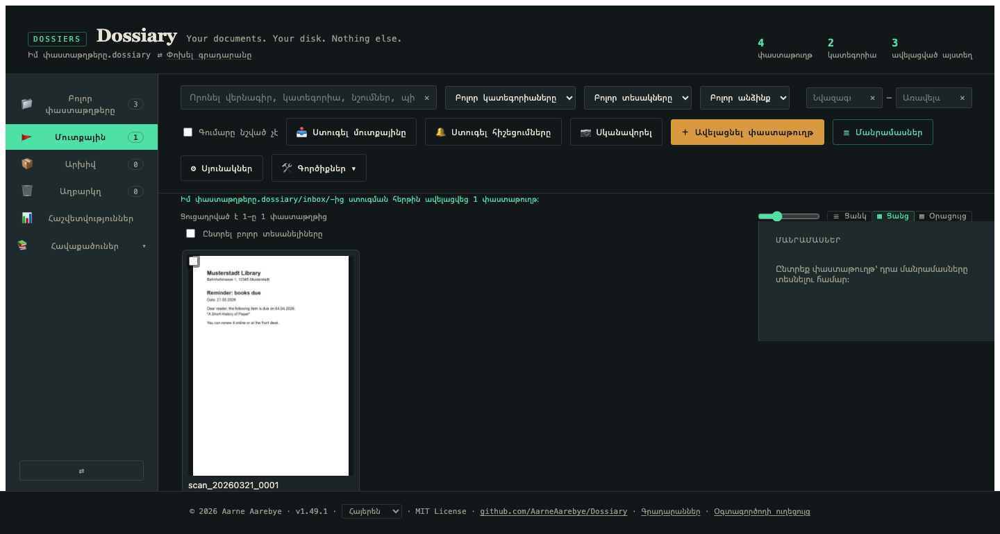
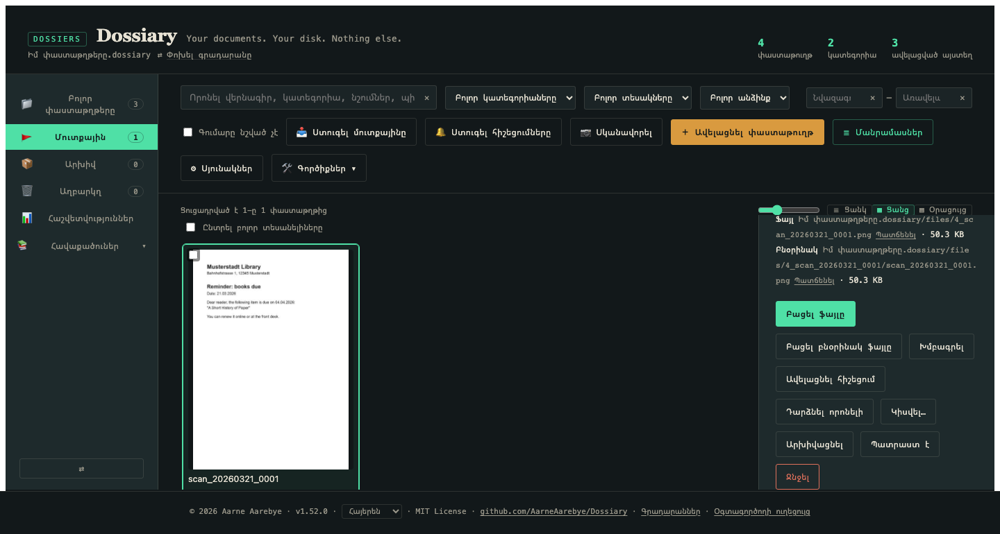
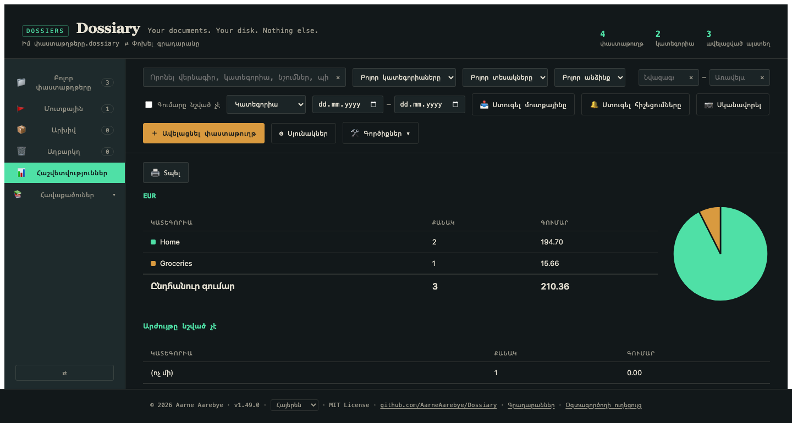

# Dossiary-ի օգտագործողի ուղեցույց

*Նո՞ր եք Dossiary-ում։ Սկսեք այստեղից։ Փնտրում եք տեխնիկական մանրամասներ՝
տվյալների բազայի կառուցվածքը, միգրացիայի ներքին աշխատանքը, թեստերի
կարգավորումը։ Այդ դեպքում կարդացեք [README.md](README.md) (անգլերեն) կամ
[README.de.md](README.de.md) (գերմաներեն)։ Այս ուղեցույցը միտումնավոր
գրված է առանց տեխնիկական մանրամասների։*

*[This guide in English](USER_GUIDE.md) · [Diese Anleitung auf Deutsch](USER_GUIDE.de.md) · [Esta guía en español](USER_GUIDE.es.md) · [Ce guide en français](USER_GUIDE.fr.md) · [简体中文版](USER_GUIDE.zh-Hans.md) · [繁體中文版](USER_GUIDE.zh-Hant.md)*

## Ի՞նչ է Dossiary-ն

Dossiary-ն Ձեր անձնական, գաղտնի փաստաթղթերի արխիվն է։ Դուք սկանավորում
կամ լուսանկարում եք Ձեր թղթային փաստաթղթերը՝ հաշիվներ, նամակներ,
անդորրագրեր, պայմանագրեր, այն ամենը, ինչ այլապես կլցնեիք դարակի մեջ, և
Dossiary-ն դրանք պահում է կարգավորված, որոնելի և ընթեռնելի՝ ընդմիշտ։

Մի քանի բան այն տարբերում է սովորական «փաստաթղթերի կառավարման
հավելվածից».

- **Դա պարզապես ֆայլ է։** Մեկ `dossiary.html` ֆայլ, որը ներբեռնում եք
  մեկ անգամ։ Ոչ տեղադրում, ոչ հաշիվ, ոչ բաժանորդագրություն։
- **Ոչինչ դուրս չի գալիս Ձեր համակարգչից։** Չկա սերվեր, չկա ամպ, ոչինչ
  չի վերբեռնվում։ Ամեն ինչ կատարվում է Ձեր դիտարկիչում, որն ուղղակիորեն
  կարդում և գրում է Ձեր իսկ սկավառակի վրա Ձեր ընտրած թղթապանակում։
- **Ձեր տվյալները մնում են Ձեզ, նույնիսկ եթե դադարեք օգտագործել
  հավելվածը։** Ձեր գրադարանը ֆայլերով սովորական թղթապանակ է (տվյալների
  բազայի փոքր ֆայլ և Ձեր բնօրինակ փաստաթղթերը), որը կարող եք բացել,
  պատճենել կամ պահուստավորել ինչպես ցանկացած այլ թղթապանակ։

Եթե սա Ձեզ հետաքրքրում է, ուղեցույցի մնացած մասը ցույց է տալիս, թե
ինչպես օգտվել դրանից գործնականում։

## Ինչպես սկսել

1. **Ներբեռնեք `dossiary.html`-ը**
   [GitHub-ի պահոցից](https://github.com/AarneAarebye/Dossiary) և բացեք
   այն Chrome-ում կամ Edge-ում (անհրաժեշտ է այս երկու դիտարկիչներից
   մեկը. Safari-ն և Firefox-ը չեն աջակցում այն տեխնոլոգիան, որով
   հավելվածը կարդում և գրում է ֆայլերը Ձեր սկավառակի վրա)։
2. Կտեսնեք «Գրադարան բացված չէ» էկրանը։ Սա նորմալ է. դա առաջին բանն է,
   որ տեսնում եք, մինչև Ձեր արխիվի համար թղթապանակ ընտրելը։

   

3. Սեղմեք **Բացել գրադարանի թղթապանակը** և ընտրեք, թե որտեղ պետք է
   գտնվի Ձեր գրադարանը, օրինակ՝ Ձեր Documents թղթապանակում։ Դիտարկիչը
   թույլտվություն կխնդրի կարդալու և գրելու այդ թղթապանակում. թույլ
   տվեք, քանի որ հենց այդպես է Dossiary-ն պահպանում Ձեր փաստաթղթերը։
4. Քանի որ այնտեղ դեռ գրադարան չկա, Dossiary-ն առաջարկում է ստեղծել
   այն։ Մուտքագրեք անուն (կամ թողեք «Իմ փաստաթղթերը») և սեղմեք
   **Ստեղծել գրադարան այս թղթապանակում**։ Dossiary-ն ստեղծում է այդ
   անունով թղթապանակ՝ `.dossiary` վերջավորությամբ՝
   `Իմ փաստաթղթերը.dossiary`, և դրա մեջ դնում է տվյալների բազայի փոքր
   ֆայլ և մի քանի թղթապանակ։ Ահա և վերջ. Ձեր սկավառակի վրա ուրիշ ոչինչ
   չի փոխվում։ (Եթե գրադարանի համար արդեն ինքներդ դատարկ թղթապանակ եք
   ստեղծել, ընտրեք այն և փոխարենը սեղմեք **Օգտագործել այս թղթապանակը
   որպես գրադարան**։)
5. Այժմ ունեք դատարկ, օգտագործման պատրաստ գրադարան, որը սպասում է Ձեր
   առաջին փաստաթղթին։

Հաջորդ անգամ, երբ ուզենաք օգտվել Dossiary-ից, պարզապես նորից բացեք
`dossiary.html`-ը. այն հիշում է այս գրադարանը և առաջարկում է այն բացել
մեկ սեղմումով։

## Ձեր առաջին փաստաթղթի ավելացումը

Սեղմեք **Ավելացնել փաստաթուղթ**։ Կբացվի ավելացման ձևը.

1. Սեղմեք վերևի կետագծված շրջանակին և ընտրեք ֆայլ՝ Ձեր փաստաթղթի
   լուսանկարը կամ սկանը (JPEG/PNG), կամ PDF։ (Եթե դեռ չեք սկանավորել
   այն, «Նախ պետք է թղթային փաստաթո՞ւղթ սկանավորել» հղումը կարճ
   խորհուրդներ է տալիս Ձեր օպերացիոն համակարգի ներկառուցված
   սկանավորման գործիքների մասին։)
2. Ֆայլն ընտրելուց հետո սեղմեք **Դարձնել որոնելի**։ Տեքստի ճանաչումը
   (OCR) կարդում է պատկերի տեքստը, որպեսզի հետո այն որոնելի լինի.
   լռելյայն Dossiary-ն ճանաչում է անգլերեն և գերմաներեն, իսկ հայերեն
   փաստաթղթերի համար լեզուների ցանկում ընտրեք **Հայերեն** (այլ լեզուներ
   նույնպես կան)։ Մի քանի վայրկյան սպասեք. ստացված տեքստը կհայտնվի
   ներքևի դաշտում, և այն կարող եք ուղղել, եթե տեքստի ճանաչումը ինչ-որ
   բան սխալ է կարդացել.

   

   Ճանաչված տեքստից Dossiary-ն առաջարկում է նաև ամսաթիվ և գումար, և այն
   հասկանում է հայերեն գրված ամսաթվերը, օրինակ՝ «2026 թ. հոկտեմբերի 17»։
   Դրամով գումարները (֏) նույնպես ճանաչվում են, ուստի հայկական
   անդորրագրի ընդհանուր գումարը կարող է լրացվել ինքնաշխատ։

3. Լրացրեք մնացածը. ընտրեք կամ մուտքագրեք **Փաստաթղթի տեսակ** (Հաշիվ,
   Նամակ, Անդորրագիր, ինչ որ իմաստ ունի Ձեզ համար. նոր տեսակները
   ստեղծվում են պարզապես դրանք մուտքագրելով), **Վերնագիր**, փաստաթղթի
   իրական **Ամսաթիվ**, **Կատեգորիա** և **Պիտակներ**, որոնցով հետո կուզեք
   զտել։ Բացի փաստաթղթի տեսակից, սրանցից ոչինչ պարտադիր չէ. լրացրեք
   միայն այն, ինչ Ձեզ օգտակար է։

   

4. Սեղմեք **Պահպանել փաստաթուղթը**։ Վերջ. Ձեր փաստաթուղթն այժմ
   ընդմիշտ Ձեր գրադարանում է՝ իր ճանաչված տեքստի հետ միասին։

Կրկնեք սա այնքան փաստաթղթի համար, որքան ցանկանում եք։ Dossiary-ն Ձեր
փաստաթղթերը ցույց է տալիս նախադիտման սալիկներով.

**☰ Ցանկ** / **▦ Ցանց** փոխարկիչը «Ցուցադրված է N-ը M փաստաթղթից»
տողի կողքին անցնում է աղյուսակի, որտեղ յուրաքանչյուր փաստաթուղթ մեկ
տող է, և հետ։ Կողքի սահիչը կարգավորում է սալիկների չափը։ Նույն
փոխարկիչի **▤ Օրացույց** կոճակը ցույց է տալիս մեկ ամիս՝ յուրաքանչյուր
փաստաթուղթն իր ամսաթվի վրա։

## Ինչպես այն նորից գտնել

Այս ամենի իմաստն այն է, որ ամիսներ կամ տարիներ անց կարողանաք որևէ բան
գտնել վայրկյանների ընթացքում։ Ձեր փաստաթղթերի վերևում.

- **Որոնել** դաշտը փնտրում է վերնագրերում, կատեգորիաներում,
  նշումներում, պիտակներում և ճանաչված տեքստում։ Այնպես որ, նույնիսկ եթե
  չեք հիշում, թե ինչպես եք անվանել փաստաթուղթը, սովորաբար բավական է
  մուտքագրել մի բառ, որը գիտեք, որ գրված էր հենց փաստաթղթի *վրա*։
- Զտիչները (կատեգորիա, տեսակ, անձ) ցանկը նեղացնում են միայն
  համապատասխանող փաստաթղթերով։
- Աղյուսակում սեղմեք ցանկացած սյունակի վերնագրի վրա՝ ըստ դրա
  դասավորելու համար. սալիկները հետևում են նույն հերթականությանը։

## Ամենօրյա թղթերի կույտը

Փաստաթղթերը մեկ առ մեկ ձևով ավելացնելը աշխատում է, բայց մարդկանց մեծ
մասը թղթերը չի ստանում մեկ-մեկ. դրանք գալիս են կույտով կամ սկաներից
դուրս են գալիս խմբաքանակով։ Դրա համար Dossiary-ն ավելի թեթև ճանապարհ
ունի՝ **Մուտքային**։

Յուրաքանչյուր գրադարան ունի `inbox` թղթապանակ՝ անմիջապես Ձեր գրադարանի
ֆայլի կողքին։ Գցեք սկանավորված ֆայլերն այնտեղ՝ ինքներդ քաշելով, Ձեր
սկաների «պահպանել թղթապանակում» գործառույթով, կամ (լիովին ավտոմատ
տարբերակի համար) կից `scan_watch.py` օգնական սկրիպտով, որը նկարագրված է
տեխնիկական README-ում, ապա Dossiary-ում սեղմեք **Ստուգել մուտքայինը**։

Այնտեղ սպասող յուրաքանչյուր ֆայլ անմիջապես ավելացվում է՝ միայն ֆայլի
անունից ստացված վերնագրով, առանց որևէ այլ լրացված տվյալի, և հայտնվում է
ստուգման հերթում, այլ ոչ թե փաստաթղթերի հիմնական ցանկում.

Սեղմեք դրանցից մեկի վրա և Ձեր տեմպով լրացրեք Ձեզ կարևոր տվյալները
(կատեգորիա, տեսակ, պիտակներ, ամսաթիվ), ապա սեղմեք **Պատրաստ է**, կամ
**Արխիվացնել**, կամ **Ջնջել**, եթե պարզվի, որ այն պահելու արժանի չէ։
Ոչինչ երբեք աննկատ չի անհետանում. այս գործողություններից յուրաքանչյուրը
կարելի է հետ շրջել փաստաթղթի մանրամասների տեսքից։

Սա է «ինչպես թղթային ամբողջ արխիվս տեղափոխեմ այստեղ» հարցի գործնական
պատասխանը. սկանավորեք ամեն ինչ խմբաքանակներով Մուտքայինի մեջ, ապա անցեք
ստուգման հերթով, երբ մի քանի ազատ րոպե ունենաք, փոխանակ յուրաքանչյուր
թերթի համար սկանավորելու պահին ուշադիր ձև լրացնելու։

## Սկանավորում անմիջապես Dossiary-ի մեջ

Եթե սկաներ ունեք, Dossiary-ն կարող է սկանավորել անմիջապես
Մուտքայինի մեջ։ Դրա համար Ձեր համակարգչում անհրաժեշտ է փոքր սկանավորման
օգնական՝ [dossiary-scan-helper](https://github.com/AarneAarebye/dossiary-scan-helper)
սկաներների մեծ մասի համար, կամ [scanix500](https://github.com/AarneAarebye/iX500)
ScanSnap iX500-ի համար։

1. Գործարկեք օգնականը։
2. Սեղմեք **📷 Սկանավորել**։ Առաջին անգամ պատուհանը զուգակցման կոդ է
   խնդրում. օգնականի ընտրացանկում ընտրեք **Pair a Browser…** և
   մուտքագրեք նրա ցույց տված 6 նիշանոց կոդը։
3. Ընտրեք Ձեր սկաները և կարգավորումները, ապա սեղմեք **Սկանավորել**։
   Էջերը հայտնվում են Մուտքայինում՝ ստուգման պատրաստ։

Dossiary-ն հաջորդ անգամվա համար հիշում է Ձեր սկաները և
կարգավորումները։ Եթե Ձեր սկաները կարող է կույտը բաժանել դատարկ
թերթերով, **📸 Բազմակի սկանավորում** կոճակը մեկ կույտից մի քանի
փաստաթուղթ է ստեղծում։

## Արագ շրջայց մնացած ամեն ինչով

Երբ վերը նկարագրված հիմունքներին ընտելանաք, կան նաև այլ բաներ, որոնք
արժե իմանալ։ Դրանցից յուրաքանչյուրն իսկապես օգտակար է, բայց ոչ մեկը
պարտադիր չէ սկսելու համար, ուստի այս բաժինը միտումնավոր կարճ է։

- **Հաշվետվություններ**՝ ընդհանուր գումարներ՝ խմբավորված ըստ
  կատեգորիայի, տեսակի կամ անձի, ամսաթվերի միջակայքի զտիչով և կարկանդակ
  գծապատկերով, որը ցույց է տալիս, թե ուր է գնացել գումարը։ Օգտակար է
  հարկային հաշվետվության կամ ծախսերի փոխհատուցման համար։ Սեղմեք տողի
  կամ հատվածի վրա՝ դրա հետևում կանգնած փաստաթղթերը տեսնելու համար։

  

- **Անդորրագրի բաժանում**. մեկ անդորրագիրը կարող է ընդգրկել մի քանի
  կատեգորիա (սուպերմարկետի հաշիվ՝ սննդամթերքով և տնային
  ապրանքներով)։ Ավելացման կամ խմբագրման ձևի դաշտերի ներքևում սեղմեք
  **+ Բաժանել կատեգորիաների միջև** և ավելացրեք մեկ տող յուրաքանչյուր
  կատեգորիայի համար՝ իր գումարով և, ցանկության դեպքում, նշումով։ Այն,
  ինչ չեք բաժանում, մնում է փաստաթղթի սեփական կատեգորիայում։ Ըստ
  կատեգորիայի հաշվետվություններն այդ դեպքում յուրաքանչյուր մաս հաշվում
  են իր տեղում, իսկ ըստ կատեգորիայի զտելը գտնում է նաև այն
  փաստաթղթերը, որոնք մասամբ են պատկանում դրան։

- **Ավելի կոկիկ գործիքագոտի**. գործիքագոտու որոշ կոճակներից չե՞ք
  օգտվում (օրինակ՝ սկաներ չունեք)։ **🛠 Գործիքներ → 👁 Գործիքագոտու
  կոճակներ…** ընտրանքը թաքցնում է դրանք այս գրադարանի համար. նորից
  նշելով՝ դրանք վերադառնում են։

- **Կիսվել**. փաստաթղթի վահանակում **Կիսվել…** կոճակը (կամ մի քանի
  ընտրված փաստաթղթի դեպքում՝ **Ավելին ▾** ընտրացանկում) ֆայլերն
  ուղարկում է Mail-ով, Messages-ով, AirDrop-ով կամ Ձեր համակարգի
  առաջարկած ցանկացած այլ հավելվածով։

- **Հավաքածուներ**. պահեք փաստաթղթերի խումբը միասին՝ կամ ձեռքով
  (ընտրեք և ավելացրեք, կամ քաշեք փաստաթղթերը կողային վահանակում
  հավաքածուի անվան վրա), կամ որպես «խելացի հավաքածու», որը նոր
  փաստաթղթերի ավելանալուն զուգընթաց ինքնաշխատ համապատասխանում է Ձեր
  ընթացիկ որոնմանը կամ զտիչին։ Թղթապանակները (Գործիքներ → Կառավարել
  հավաքածուները) երկար ցանկը կարգի են բերում։

- **Արխիվ**. «այլևս կարիք չունեմ սա տեսնելու իմ ամենօրյա ցանկում,
  բայց մի՛ ջնջիր» նշում, որն առանձին է Աղբարկղից։
- **Աղբարկղ**. փաստաթուղթը ջնջելը սկավառակի վրա ոչինչ չի ոչնչացնում.
  այն տեղափոխվում է Աղբարկղ և ընդմիշտ լիովին վերականգնելի է մնում
  («դատարկել աղբարկղը» կոճակ չկա. այս հավելվածը երբեք վերջնականապես չի
  ոչնչացնում Ձեր տվյալները)։
- **Հատուկ դաշտեր**. ներկառուցված դաշտերից բացի կարող եք ավելացնել Ձեր
  սեփականները (Հեղինակ, Վճարված, Փոխհատուցվող, ինչ որ պետք է Ձեր
  փաստաթղթերին) անմիջապես ավելացման կամ խմբագրման ձևից՝ ըստ փաստաթղթի
  տեսակի։
- **Հիշեցումներ**. հատուկ դաշտին տվեք «Հիշեցում» տեսակը (Երկարաձգման
  ամսաթիվ, Երաշխիքի ավարտ, ինչը հետագա գործողություն է պահանջում), և
  Dossiary-ն Ձեզ կտեղեկացնի, երբ ժամկետը գա՝ կամ ինքնաշխատ գրադարանը
  բացելիս, կամ գործիքագոտու «🔔 Ստուգել հիշեցումները» կոճակով, ինչպես
  նաև հետաձգելու հնարավորությամբ, եթե դեռ պատրաստ չեք զբաղվել դրանով։
  Արագ, մեկանգամյա հիշեցման համար, առանց դաշտ կարգավորելու, սեղմեք
  ցանկացած փաստաթղթի վրա մկնիկի աջ կոճակով և ընտրեք «Ավելացնել
  հիշեցում»։ Ֆոնային ռեժիմում ոչինչ չի աշխատում. Dossiary-ն ստուգում է
  միայն այն ժամանակ, երբ իսկապես բացում եք այն կամ սեղմում կոճակը։

- **Մեկ գրադարան ամեն տարվա համար**. նոր գրադարան ստեղծելիս «Պատճենել
  կարգավորումը՝» ընտրանքը կարող է այն սկսել մեկ այլ գրադարանի հատուկ
  դաշտերով, փաստաթղթերի տեսակներով, դաշտերի նկարագրություններով,
  խելացի հավաքածուներով և կարգավորումներով։ Նրա փաստաթղթերը մնում են
  իրենց տեղում։

## Ինչ անել հետո

- Հետաքրքի՞ր է, թե ինչպես է Dossiary-ն իրականում պահում Ձեր տվյալները,
  կամ ուզում եք տեսնել գործառույթների ամբողջական ցանկը և դրանց
  առանձնահատուկ դեպքերը։ Կարդացեք տեխնիկական [README](README.md)-ն
  (անգլերեն)։
- Տեղափոխվում եք Mariner Paperless-ի հին գրադարանի՞ց։ Կարդացեք
  [MIGRATION.md](MIGRATION.md)-ն (անգլերեն). դա մեկանգամյա փոխակերպման
  քայլ է, որը այս ուղեցույցը չի ներառում։
